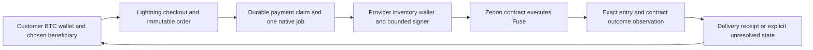

# Architecture and delivery contract

Draft 0.2 | Source observations through 28 October 2026 | Prepared by edgepillar

[Overview](../README.md) | [Proposal](proposal.md) | [Architecture](architecture.md) | [Experiment plan](experiment-plan.md) | [Sources](../evidence/sources.md)

Start with one operator, one resource product and one Lightning adapter. Reuse an L402 gateway where its selected implementation meets the order authorization requirements. Treat x402 exact/lnbtc as a later compatibility target rather than building several protocols at once. Do not change a wire standard under an existing scheme name. [S10](https://github.com/lightninglabs/L402/blob/master/protocol-specification.md) [S11](https://github.com/lightninglabs/aperture) [S12](https://github.com/x402-foundation/x402/blob/main/specs/schemes/exact/scheme_exact_lnbtc.md)

BTC payment and native fulfillment are separate events. This service needs no BTC bridge or swap. Full node observations retain explicit operator trust.

## The thing being sold

Sell a stated amount of QSR fused for a stated beneficiary under a pinned chain profile, with a minimum cancellation height or another explicitly enforceable duration condition. A quote must not promise a fixed number of transactions or a fixed wall clock service period from an unverified resource model. Confirm actual runtime constants and network overrides; a tagged constants file alone does not establish mainnet timing. [S09](https://github.com/zenon-network/go-zenon/blob/v0.0.9-alphanet/vm/constants/embedded.go)

Create an immutable order before issuing a payment challenge. It records an opaque order ID, provider, chain and genesis identity, beneficiary, QSR amount, price in sats, quote expiry, delivery deadline, minimum service condition, compensation terms and version. Reserve eligible inventory atomically. Scope the credential to that order and reject mutations after payment. For L402, distinguish server enforced order scoping from whatever cryptographic invoice binding the selected implementation actually provides.

## Payment and fulfillment states

Use separate durable records for payment, authorization, native execution and delivery. A successful payment claim creates one job in the same database transaction or through an equivalent durable inbox and outbox. The provider serializes its account chain, prepares the allowed Fuse call, and stores original signed bytes and hash before publication. A publication timeout becomes unknown; reconciliation uses that same transaction. It cannot authorize another fusion or a fresh charge.

Delivery requires observing the exact provider owned entry and its successful contract processing, checking the intended beneficiary, amount, identity and service condition. The release RPC lists entries by owner; a beneficiary's aggregate plasma reading cannot identify which order was delivered. Match the order to its fusion ID and provider, then record the node and depth policy used. An accepted send alone is insufficient. [S08](https://github.com/zenon-network/go-zenon/blob/v0.0.9-alphanet/rpc/api/embedded/plasma.go)

These are operator trusted full node observations. The current SPV contract does not authenticate state values or establish consensus finality. Agreement between selected RPCs can reveal disagreement but does not replace those missing guarantees. Label evidence accordingly rather than calling the delivery receipt trustless. [S29](https://github.com/edgepillar/zenon-spv/blob/main/docs/verification-contract.md)

## Inventory and compensation

Paid promises require a protected inventory policy. The provisioner's documented automatic recycling behavior is a reason to review eligibility before reuse, not an assumed paid service guarantee. Never recycle an entry while its sold condition still applies. Reclaimed QSR is available for new promises only after the return and required receive processing are established. [S04](https://github.com/0x3639/plasma.bot) [S06](https://github.com/zenon-network/go-zenon/blob/v0.0.9-alphanet/vm/embedded/implementation/plasma.go)

The initial design uses an upfront payment with explicit provider delivery and compensation obligations. This is not an atomic BTC to resource exchange. Cancellation of a settled Lightning invoice is not a refund; compensation requires a separately authorized payment or another agreed remedy. Preserve any uncertain compensation outcome rather than paying twice. [S17](https://lightning.engineering/api-docs/api/lnd/invoices/cancel-invoice/)

A separately specified hold invoice experiment may be useful later, with measured timeout and liquidity costs. Do not insert it into the upfront exact/lnbtc scheme. An unpaid hold that outlasts an irreversible native action can expose the provider; a hold invoice alone cannot make that action atomic or judge service quality. [S15](https://lightning.engineering/api-docs/api/lnd/invoices/add-hold-invoice/) [S12](https://github.com/x402-foundation/x402/blob/main/specs/schemes/exact/scheme_exact_lnbtc.md)

## Signer and privacy boundaries

The provider uses its own narrowly funded inventory wallet. Public input cannot request arbitrary account blocks or arbitrary recipients outside the purchased order. Retain standard wallet and library boundaries. A customer's keys never enter the fulfillment service. Any unattended signer requires its own reviewed permissions; interactive extension consent does not grant automatic signing authority. [S36](https://github.com/sol-znn/syrius-extension/blob/master/docs/INTEGRATION.md) [S13](https://github.com/lightningdevkit/ldk-node) [S14](https://github.com/bitcoindevkit/bdk)

Store only the information needed to reconcile an order, with access controls and a retention policy. A gateway can correlate a Lightning payment with a Zenon address; pseudonyms do not remove that privacy risk. Keep raw journals, preimages, signed payloads, account linkage, credentials and private endpoints out of public results. Publish aggregates with small cell suppression and review timing leaks.
