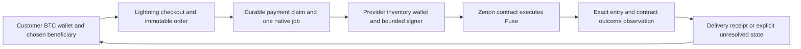

# Architecture and delivery contract

Draft 0.3 | Source review 28 October 2026 | Prepared by edgepillar

[Overview](../README.md) | [Proposal](proposal.md) | [Architecture](architecture.md) | [Experiment plan](experiment-plan.md) | [Sources](../evidence/sources.md)

Start with one operator, one resource product and one Lightning adapter. Reuse an L402 gateway where its selected implementation meets the order authorization requirements. Treat x402 exact/lnbtc as a later compatibility target rather than building several protocols at once. Do not change a wire standard under an existing scheme name. [S10](https://github.com/lightninglabs/L402/blob/592203a95ea297fad6d7e10c6de2d827bfd450b2/protocol-specification.md) [S11](https://github.com/lightninglabs/aperture/blob/f6d91e78f22b445fea8e112f30172e5ea8b6cff3/README.md) [S12](https://github.com/x402-foundation/x402/blob/5847ee5a368130df48bd6ff958e1519de4c41163/specs/schemes/exact/scheme_exact_lnbtc.md)

BTC payment and native fulfillment are separate events. This service needs no BTC bridge or swap. Full node observations retain explicit operator trust.

## Reuse the existing backend without assuming paid-service guarantees

The reviewed Plasma Bot already has shared lease-aware execution, reservations, paged reconciliation, recycling and a bounded send queue. Reuse and adapt those components rather than invent their categories again. Their presence is source evidence, not acceptance of this proposed paid contract.

| Existing source | Boundary for a paid adapter |
| --- | --- |
| Shared executor checks the request lease and handles reservation release. [S57](https://github.com/0x3639/plasma.bot/blob/ada5a03a458c17c18083fcc099276248e8f611fe/backend/src/services/fuseExecutor.ts) | Bind the paid order, liability and exact native intent durably; do not equate the executor's response with final delivery. |
| Reconciliation includes FIFO selection among entries sharing beneficiary and amount. [S58](https://github.com/0x3639/plasma.bot/blob/ada5a03a458c17c18083fcc099276248e8f611fe/backend/src/cron/reconcile.ts) | A paid receipt must use the original send hash and owner. A similar entry, unused candidate or missing observation cannot substitute for the paid order's identity. |
| Recycling selects revocable entries to restore wallet balance. [S59](https://github.com/0x3639/plasma.bot/blob/ada5a03a458c17c18083fcc099276248e8f611fe/backend/src/services/unfuse.ts) | Protect paid conditions and establish the actual QSR return before selling inventory again. |
| Send serialization is an in-process promise queue with timeouts. [S60](https://github.com/0x3639/plasma.bot/blob/ada5a03a458c17c18083fcc099276248e8f611fe/backend/src/services/sendQueue.ts) | A process-local queue is not a durable multi-worker lease. Timeout does not prove an underlying asynchronous send was canceled. Hold an uncertain native intent for reconciliation instead of treating queue progress as permission for a replacement. |

The integration should be sized after agreeing those boundaries with the operator. This review does not assert a deployed incident or independently qualify the existing bot.

## The thing being sold

Sell one identified QSR fusion for a stated beneficiary under a pinned chain profile. In the reviewed contract, the entry ID is the original Fuse send hash. The contract sets `expirationHeight` from its execution momentum height plus `FuseExpiration`; this is the earliest height at which its owner may cancel. It is not automatic cancellation, a selectable lease duration or a wall clock expiry. A later cancellation is still required to remove the entry and return QSR. [S06](https://github.com/zenon-network/go-zenon/blob/bb39e31c608dc397a91b98b21b096bca99a9f4d6/vm/embedded/implementation/plasma.go)

For the first product, quote the amount in atomic QSR units, beneficiary and a minimum cancellation height floor under the qualified rules. Accept delivery only if the observed entry meets that floor. An operator promise to retain it longer is a contractual obligation, not a stronger protocol lock, and must be labeled separately. Confirm runtime constants and network overrides. Never advertise a guaranteed transaction count, transaction inclusion, fixed plasma balance or fixed wall clock term from these sources. [S09](https://github.com/zenon-network/go-zenon/blob/bb39e31c608dc397a91b98b21b096bca99a9f4d6/vm/constants/embedded.go)

The allocation is not exclusive capacity reserved for a particular application. The beneficiary may use resources for other actions. Before a paid quote, check whether the intended task already has adequate resources or free provision, and whether the proposed additional fusion would add useful capacity under the selected rules. Refuse to sell a claimed resource improvement that the operator cannot substantiate. Execution of the customer's task is a separate outcome.

Create an immutable order before issuing a payment challenge. It records an unpredictable order ID, provider and inventory account, bitcoin network, Zenon chain and genesis identity, beneficiary, QSR amount, price in integer sats, quote expiry, delivery deadline, cancellation height floor, compensation terms and schema version. Reserve eligible inventory atomically. Quote expiry, invoice expiry, delivery deadline and native cancellation eligibility are different fields.

Keep QSR atomic units, sats and the gateway's invoice units explicit. Compare integer values with checked conversions; never infer denomination from an untyped number. In particular, the separate x402 exact/lnbtc specification uses millisatoshi amounts. Reusing its wire fields later requires an explicit protocol adapter, not copying this order's sats value into that field. [S12](https://github.com/x402-foundation/x402/blob/5847ee5a368130df48bd6ff958e1519de4c41163/specs/schemes/exact/scheme_exact_lnbtc.md)

Bind the invoice network, issuer, payment hash and amount to that order. Verify the selected L402 credential and its restrictions, including the order and operation, before granting authority. The application needs durable order state even if credential verification itself is stateless. A successful authorization must resolve to the server's immutable order; client headers cannot substitute another beneficiary, product or price. This order contract is proposed application behavior, not a claim that stock Aperture implements it. [S10](https://github.com/lightninglabs/L402/blob/592203a95ea297fad6d7e10c6de2d827bfd450b2/protocol-specification.md) [S11](https://github.com/lightninglabs/aperture/blob/f6d91e78f22b445fea8e112f30172e5ea8b6cff3/README.md)

## Payment and fulfillment states

Use separate durable records for payment, authorization, native execution and delivery. The following is a proposed contract for an adapter; none of these transitions is implemented or tested in this repository.

| Record | Required transition and invariant |
| --- | --- |
| Order | `QUOTED` reserves inventory and fixes terms. Expiry releases an unpaid reservation but does not erase a payment liability. |
| Payment | Bind the verified payment to the quoted network, issuer, hash and amount. Persist one order association for that payment identity and reject reassignment. Track verified revenue separately from possession of a client credential. |
| Authorization | A database transaction creates or recovers one fulfillment job per order, with a unique job key and durable inbox/outbox. Valid L402 credential reuse may read or retry that same order; it cannot authorize another fusion. |
| Native intent | Serialize the provider account, freeze its frontier and the permitted Fuse call, and persist the intent before asking the signer. No other writer may use that account outside the coordinator. |
| Signed payload | The signer boundary must recover the same durable signed bytes and hash after response loss. A crash between signing and persistence is an unresolved acceptance case; do not silently sign a replacement. Publication may retry only the stored bytes. |
| Delivery | `OBSERVED` requires the exact native entry and contract result under the declared observation policy. An ambiguous publication or observation stays `UNRESOLVED`; account advancement does not justify a new authorization. |
| Remedy | Keep a separate compensation liability and payment identity. Completion requires evidence of the actual remedy, not a request to send it. |

These invariants aim at one native authorization with recoverable repeat requests. They do not claim an atomic database-to-chain transaction or exactly once execution under all failures. Any implementation must demonstrate the crash boundaries before real value use.

Delivery requires observing successful contract processing and the exact entry indexed by provider owner and original Fuse send hash. Check beneficiary, QSR amount and cancellation eligibility against the order. The release RPC lists entries by owner, with pagination; an adapter must not mistake a missing first-page entry for absence. A beneficiary's aggregate plasma reading cannot identify which order was delivered. Record the observation anchor, node identity, entry ID and depth policy privately. An accepted send alone is insufficient. [S06](https://github.com/zenon-network/go-zenon/blob/bb39e31c608dc397a91b98b21b096bca99a9f4d6/vm/embedded/implementation/plasma.go) [S08](https://github.com/zenon-network/go-zenon/blob/bb39e31c608dc397a91b98b21b096bca99a9f4d6/rpc/api/embedded/plasma.go)

These are operator trusted full node observations. The current SPV contract does not authenticate state values or establish consensus finality. Agreement between selected RPCs can reveal disagreement but does not replace those missing guarantees. Label evidence accordingly rather than calling the delivery receipt trustless. [S29](https://github.com/edgepillar/zenon-spv/blob/2776e2b38847bc7b7bc338cb750663b83c92a04d/docs/verification-contract.md)

## Inventory and compensation

Paid promises require a protected inventory policy. The provisioner's documented automatic recycling behavior is a reason to review eligibility before reuse, not an assumed paid service guarantee. Never recycle an entry while its sold condition still applies. Reclaimed QSR is available for new promises only after the return and required receive processing are established. [S04](https://github.com/0x3639/plasma.bot/blob/ada5a03a458c17c18083fcc099276248e8f611fe/README.md) [S06](https://github.com/zenon-network/go-zenon/blob/bb39e31c608dc397a91b98b21b096bca99a9f4d6/vm/embedded/implementation/plasma.go)

Use a dedicated paid-inventory account by default, outside the provisioner's existing automatic FIFO recycling pool. Sharing an account would require a separately reviewed eligibility mechanism that excludes every protected paid entry. That policy and the existing public response shape are reuse boundaries that need explicit adaptation. Stop new quotes when the signer, durable database, observation policy or compensation reserve is unavailable. Before a pilot, the operator must declare maximum fused QSR, unsettled and paid-undelivered orders, refund liabilities, signer exposure and an incident response deadline. This draft assigns no live budget.

A payment can settle after the quote reservation has expired. Record the liability against the original terms, then either fulfill it safely or apply the agreed remedy. Do not discard it, silently reprice it or borrow another customer's protected allocation. Invoice cancellation alone does not prove no payment can still be observed; reconcile the authoritative payment state.

The initial design uses an upfront payment with explicit provider delivery and compensation obligations. This is not an atomic BTC to resource exchange. Cancellation of a settled Lightning invoice is not a refund; compensation requires a separately authorized payment or another agreed remedy. Preserve any uncertain compensation outcome rather than paying twice. [S17](https://lightning.engineering/api-docs/api/lnd/invoices/cancel-invoice/)

A separately specified hold invoice experiment may be useful later, with measured timeout and liquidity costs. Do not insert it into the upfront exact/lnbtc scheme. An unpaid hold that outlasts an irreversible native action can expose the provider; a hold invoice alone cannot make that action atomic or judge service quality. [S15](https://lightning.engineering/api-docs/api/lnd/invoices/add-hold-invoice/) [S12](https://github.com/x402-foundation/x402/blob/5847ee5a368130df48bd6ff958e1519de4c41163/specs/schemes/exact/scheme_exact_lnbtc.md)

## Signer and privacy boundaries

The provider uses its own narrowly funded inventory wallet. Public input cannot request arbitrary account blocks or arbitrary recipients outside the purchased order. Retain standard wallet and library boundaries. A customer's keys never enter the fulfillment service. Any unattended signer requires its own reviewed permissions; interactive extension consent does not grant automatic signing authority. [S36](https://github.com/sol-znn/syrius-extension/blob/8edb3632014e6dec1206bcd13f876d01c3696947/docs/INTEGRATION.md) [S13](https://github.com/lightningdevkit/ldk-node/blob/9386a1c92bf9515c349fb33ae80496542fdd9ddc/README.md) [S14](https://github.com/bitcoindevkit/bdk/blob/f2528da88b1041bdddf547d677511aea19ad3573/README.md)

Store only the information needed to reconcile an order, with access controls and a retention policy. A gateway can correlate a Lightning payment with a Zenon address; pseudonyms do not remove that privacy risk. Resource allocations are visible on the native chain. Do not expose payment-to-beneficiary mappings through a public status endpoint or analytics export.

Keep raw journals, invoices, preimages, signed payloads, addresses, transaction identifiers, account linkage, credentials and private endpoints out of public results. Hashing an address or invoice ID is not an anonymity guarantee. Publish coarse aggregates with a prespecified small-cell rule, such as suppressing cells smaller than five, and review timestamp, amount and cross-table linkage. The suppression threshold is a proposed reporting rule, not a mathematical privacy guarantee.

The operator and signer remain trusted for custody of provider inventory and delivery. The customer retains their own keys. This design does not establish fair exchange, anonymity, native state proofs or protection against a malicious operator; those limits must be visible before payment.
